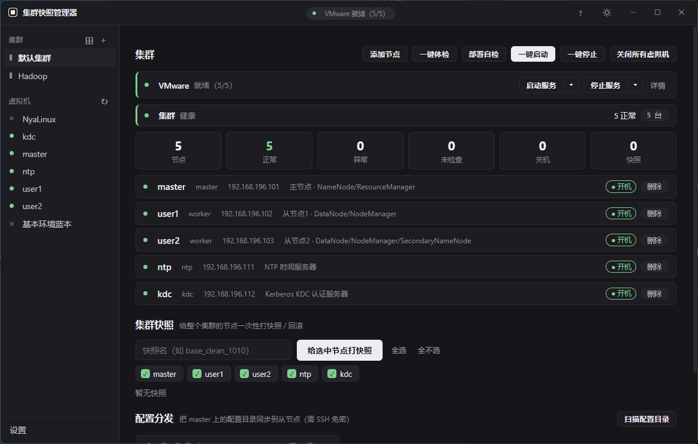

# Checkpoint

The **"diagnose/rescue + experiment helper"** tool for a **local VM cluster** — built for students running Hadoop / big-data experiments on local virtual machines.

It bundles snapshot rollback, health check, one-click start/stop, fault diagnosis, and config distribution into one UI: **snapshot before experiments, readable health checks when things go wrong, one-click revert when it breaks.**

> **Simple to operate, but it won't think for you** — one-click actions and readable errors, but only advice, never auto-fix. Learning preserved.

> Current version: **v0.11.3**

---

## Why this tool

Students learning big data often build clusters (Hadoop / Hive / Spark / Kerberos…) from several local VMs. A few pain points keep coming up:

1. **Fragile, hard to recover** — one wrong config and the whole cluster won't start; only a reinstall (hours) fixes it
2. **Unreadable errors** — `Connection refused`, `command not found`… beginners don't know what's wrong or how to fix it
3. **Tedious operations** — starting a cluster means memorizing a pile of commands, one node at a time
4. **Environment is not reusable** — once Kerberos is installed, the environment is "specialized" and awkward for other experiments

Enterprise cluster-management tools (built for server ops) are too heavy; general open-source tools are too geeky; snapshot tools do only one thing — **none fits the "local VMs + student experiments" scenario**. Checkpoint fills that gap: lightweight (pywebview, ~18MB exe), beginner-friendly (traffic lights + readable errors + one-click), and it **shows the commands behind every action** so students learn as they go — but it only does **diagnosis and rescue** — it won't think for the student.

> Docs tell you the "steps"; this tool covers the blind spot: **when something breaks, it helps you find and fix it.**

---

## Features

### UI
- **Left activity bar**: sections by purpose (Environment / Data / Jobs / Tools / Settings)
- **Objects + tabs**: clusters and nodes each have their own tabs (cluster: Overview / Nodes / Service Topology / Resources / Snapshots / Config Dist; node: Health / Services / Snapshots / Config / Terminal)
- **Bottom panel**: Output / Tasks / Terminal, collapsible, drag-to-resize (VSCode-style)
- **Visible commands**: each action shows the **actual commands it runs** (commented, params explained), hover for purpose — you learn as you go; collapsible & copyable
- Theme styles (Dashboard / Terminal / Blueprint), UI zoom, window edge-resize

### Data & Jobs
- **HDFS operations**: browse / upload / download / mkdir / delete / rename / search (with tree)
- **Hive query**: SQL editor (syntax highlighting) + schema/table tree + result table
- **Table manager / Data import**: browse Hive tables, create tables from HDFS files
- **HBase browser** (shown only if HBase is installed)
- **YARN apps**: list / status / logs / kill
- **Job templates**: WordCount / TestDFSIO / TeraSort / Spark, one-click run
- **Cluster verification**: WordCount smoke test (verify the whole MapReduce pipeline)
- **Post-deploy check**: DataNode registration, safemode

### Tools
- **Sanitized diagnostic pack**: bundle environment info (passwords removed, IPs masked)
- **Declarative cluster config**: export / import cluster topology as JSON
- **Config templates**: standard core-site / hdfs-site templates
- **Result export**: health-check result to markdown

### VMs & Snapshots
- **Auto-discovery**: reads VMware records to find local VMs (cached, instant)
- **Snapshot management**: create / revert / delete, **tree view**, **clone to a new VM**
- **Cluster snapshots**: batch snapshot / revert for the whole cluster, with per-node selection
- **Runtime status**: view running VMs, start / stop / shut down all
- **Custom labels**: display names inside the app (e.g. "master")

### Cluster Management
- **Cluster nodes**: configure nodes (IP / credentials / role / cluster), **multi-cluster**
- **Cluster templates**: one-click node skeleton (Hadoop 3-node / Hadoop+Kerberos 5-node)
- **One-click start/stop**: ordered by dependency (NTP → KDC → HDFS → YARN → HistoryServer)
- **Health check**: online / processes / ports / services (traffic-light status)
- **Pre-deploy check**: Java / hosts / SSH / time / SELinux / firewall
- **Config distribution**: scan master config dirs, rsync to workers (per-node root supported)

### Diagnosis & UX
- **Plain-language errors**: common errors translated into "cause + fix" (24 rules)
- **VMware env management**: status light + per-service start/stop + launch VMware
- **Skip powered-off nodes**: instant, no timeout wait
- **Concurrency lock**: buttons disabled during operations
- **Light/dark theme**, ZH/EN switch, UI animations
- **UI style themes**: switchable Dashboard / Terminal / Blueprint styles (a theming system that can customize layout & fonts)
- **UI zoom**: Ctrl + / Ctrl - / Ctrl 0, remembered
- **Frameless window edge-resize**: drag window edges to resize
- **Update check** + global exception capture (\`error.log\`)

---

## Screenshots

> Left activity bar switches sections; right pane shows overview, node list, snapshots, config distribution, etc. (screenshot from an earlier version)

---

## Prerequisites

This tool is for **local VM cluster experiments**. You need:

1. **VMware Workstation / Player** (the app uses its \`vmrun.exe\`)
2. **Several Linux VMs** (e.g. CentOS 7) forming a cluster (master / user1 / user2 / ntp / kdc)
3. Nodes **network-reachable** and **SSH-accessible** (config distribution also needs **SSH key** from master to workers)

> No cluster yet? Build one first (or use a **cluster template** to generate the node skeleton), then come back for health check / start-stop / diagnosis.

---

## Quick Start

1. **Open the app** → go to the cluster page under the "Environment" section
2. Click **＋ New Cluster** (or **⊞ Template** to generate a standard skeleton)
3. **Add nodes**: fill IP / user / password / role (linking a VM auto-fills config)
4. Click **Health Check** → see traffic lights (🟢 ok / 🟡 partial / 🔴 error / ⚪ off)
5. Problems? Use **Deploy Check**; start/stop failures show **readable diagnosis**
6. **Snapshot** before experiments; one-click **revert** if things break
7. Transfer data / run queries / watch jobs? Switch to the **Data** / **Jobs** section (HDFS / Hive / YARN)

> Each action shows the commands it runs (collapsible) — **hover a command to see what it does; you'll learn the CLI as you go.**

---

## Usage

### Option 1: Installer (recommended)

1. Download `Checkpoint-Setup.exe`
2. Double-click, choose install location
3. Launch from the desktop shortcut

**Requirement**: VMware Workstation / Player installed.

### Option 2: Run from source

\`\`\`bash
pip install pywebview paramiko
python app.py
\`\`\`

---

## Tech Stack

- **pywebview**: Python + embedded WebView desktop window
- **Frontend**: vanilla HTML / CSS / JavaScript (no framework)
- **Backend**: Python (calls VMware's \`vmrun\` CLI + SSH via paramiko)
- **Packaging**: PyInstaller (standalone exe) + Inno Setup (installer)

---

## Config Files

Generated at runtime **next to the program**:

- \`settings.json\` — settings (vmrun path, language, etc.)
- \`nodes.json\` — cluster nodes (IP / credentials / role)
- \`aliases.json\` — VM display names / notes
- \`vms_cache.json\` — VM scan cache
- \`health_cache.json\` — last health-check result
- \`error.log\` — error log

---

## Changelog

- **v0.11.3** (2026-10-15): **Settings improvements** — Kerberos config supports "Auto read" (auto-fill realm, principal, keytab from master's krb5.conf / hdfs-site.xml); unified settings layout (fixed-width inputs, consistent spacing).
- **v0.11.2** (2026-10-15): **Resource monitor enhancements** — collect **all nodes** (not just master), each showing CPU / memory / disk usage with progress bars; **auto-refresh** toggle (in Settings, every 5s, persisted); HDFS capacity as a full-width row with readable values. **Unified checkbox style**.
- **v0.11.1** (2026-10-15): **HDFS permission readable diagnosis** — on HDFS write failures (mkdir/upload/delete/rename), a dialog explains "why + what to do" (e.g. Permission denied → use /tmp or sudo -u hdfs); the built-in terminal appends suggestions too. Kerberos check adds a "HDFS ownership" item. The switch-to-simple dialog now shows a two-environment command comparison.
- **v0.11.0** (2026-10-15): **Kerberos environment management** — config backup/restore + change alert, Kerberos config check (13 items, tri-state), one-click hdfs/yarn SSH key setup, one-click kerberos↔simple switch (declarative + auto-backup + visible commands), config diff view; **frameless window resize** via native pywebview API; bottom **Output panel** (command history); collapsed command blocks by default, tab caching (no flicker), shutdown no longer misreports failure when VM is already off.
- **v0.10.0** (2026-10-12): **UI revamp** (left activity bar + object tabs + bottom panel), **visible commands** (every action shows the commands it runs + comments), **HDFS / Hive / Table manager / Data import / HBase / YARN / Job templates**, **cluster + post-deploy verification**, **sanitized diagnostic pack**, **declarative cluster config**, **config templates**, **node terminal**, **result export**, **service topology + resource monitor**, 24 diagnosis rules, Kerberos switch. See the dev log.
- **v0.9.4** (2026-10-11): Fixed theme-switch bug (switching back to "Default" left stale theme DOM, losing rounded corners).
- **v0.9.3** (2026-10-11): **UI style themes** (Dashboard / Terminal / Blueprint, each with its own layout & colors), **UI zoom** (Ctrl +/-/0), **frameless window edge-resize**, **scrollbar polish** (hidden until scrolling).
- **v0.9.2** (2026-10-11): First-use guide (3-step card when cluster is empty), in-app help (? button).
- **v0.9.1** (2026-10-11): Config distribution overhaul (auto-scan + manual path + per-node root + readable failures), concurrency locks, skip powered-off nodes, faster startup (TCP probe), VMware pre-checks.
- **v0.9.0** (2026-10-11): Config distribution (auto-scan), snapshot tree view, clone snapshot to VM, pre-deploy check, button tooltips.
- **v0.8.0** (2026-10-11): Cluster templates, health-result persistence, UI animations, clone snapshot, pre-deploy check, config distribution, readable errors.
- **v0.7.0** (2026-10-11): vCenter-style UI rebuild, multi-cluster, cluster snapshots, cluster overview, readable errors, pre-deploy check, config distribution.
- **v0.6.0** (2026-10-11): VMware env management, cluster start/stop improvements, health check enhancements, node notes.
- **v0.5.0** (2026-10-10): UI成型 (health card + detail tabs), port check, post-start self-check, auto health check.
- **v0.4.0** (2026-10-10): One-click cluster start/stop (dependency-ordered).
- **v0.3.0** (2026-10-10): Cluster node management + one-click health check.
- **v0.2.0** (2026-10-10): Language switch (ZH/EN), check for updates.
- **v0.1.0** (2026-10-10): First release. Auto-discovery, snapshot management, labels, theme switch, installer.

---

## License

This project is licensed under the **GNU General Public License v3.0 (GPLv3)** — see [LICENSE](LICENSE).
